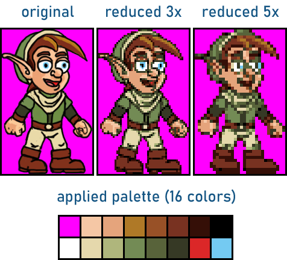

# RetroScale

**RetroScale** is a command-line tool that converts a PNG image into pixel art by reducing its size and applying a color palette chosen by the user. The reduction and palette mapping are performed together, using perceptual color distances to find the best palette color for each output pixel.

## What is the use of this?

Creating pixel art from a larger image involves both reducing its resolution and limiting its colors. Applying these steps separately can discard useful information: once a block of original pixels has been reduced to a single color, the palette mapping can no longer consider all the colors that were present in that block.

RetroScale is specialized in pixel art and combines both steps in a single operation. For each output pixel, it considers every original pixel in the corresponding block and chooses the palette color that best represents the whole block. Color differences are measured in **CIELAB**, a perceptual color space, rather than directly in RGB, so that the comparison better reflects how people perceive differences between colors.

The tool deliberately does **not** attempt to generate a palette automatically. Instead, you are expected to choose a suitable palette manually. This gives you control over the final look and ensures that the colors you want to have are available.

## A practical example

The example below shows the original image, reductions by 3x and 5x, and the palette used for both conversions. Magenta is used as a transparency mask color.



## How does it work?

The reduction factor determines the block of original pixels represented by each output pixel. For example, a factor of **4** turns each 4-by-4 block into one pixel, reducing both the image width and height to one quarter of their original sizes.

For each block, RetroScale compares every color in the supplied palette against every original pixel in that block. It adds up the squared CIELAB distances and selects the palette color with the smallest total. The result is saved as an **indexed PNG**, using the supplied palette.

Only complete blocks are processed. If the original dimensions are not divisible by the reduction factor, the remaining pixels along the right and bottom edges are discarded.

## How to use it

You can run RetroScale with a command like this:

```sh
retroscale input.png output.png palette.pal 4
```

The arguments, in order, are:

- The input PNG image.
- The output PNG image.
- The palette file.
- A positive integer reduction factor.

Only **PNG** images are supported for input and output. Palettes must contain between **1 and 256 colors**. The palette format is detected from the file contents, with support for:

- **JASC-PAL**: text palettes, such as those exported by Aseprite as PAL.
- **RIFF PAL**: binary Windows palettes, such as those exported by Photoshop as PAL.
- **ACT**: Adobe color tables, with either 768 or 772 bytes.
- **HEX**: text palettes with one six-digit RGB hexadecimal color per nonempty line.

For example, using the supplied image and JASC-PAL palette:

```sh
retroscale Example/Original.png output.png Example/PaletteFormats/Palette_PAL_JASC.pal 3
```

**Alpha channels and transparency are not supported.** Prepare the image with an opaque mask color instead, include that color in the palette, and treat it as transparent in the application or engine where you use the result. This is commonly the first color in the palette. In the example above, the mask color is **magenta**. RetroScale processes it as an ordinary RGB color and does not mark it as transparent in the output PNG.

## How to build from source code

This project uses **C++11**, **CMake**, and **libpng** to load and save PNG images. Note that libpng, in turn, requires **zlib**. Install these dependencies and make sure CMake can find them before configuring the project.

Run one of the following alternatives from the project root.

**Windows, with Visual Studio (example for VS 2022)**:

```bat
cmake -S . -B build -G "Visual Studio 17 2022" -A x64
cmake --build build --config Release
```

**Windows, using MSYS2/MinGW**:

```sh
cmake -S . -B build -G "MSYS Makefiles" -DCMAKE_BUILD_TYPE=Release
cmake --build build
```

**Linux and macOS**:

```sh
cmake -S . -B build -DCMAKE_BUILD_TYPE=Release
cmake --build build
```

Once the build is successful, you can run the executable from the build folder or copy it to a directory on your command search path. Visual Studio places the Release executable in `build/Release`.

## License

This program and its source code are made by Carra, and offered under the **BSD 3-Clause License** (`BSD-3-Clause`). See the full license text [here](https://opensource.org/license/bsd-3-clause).
